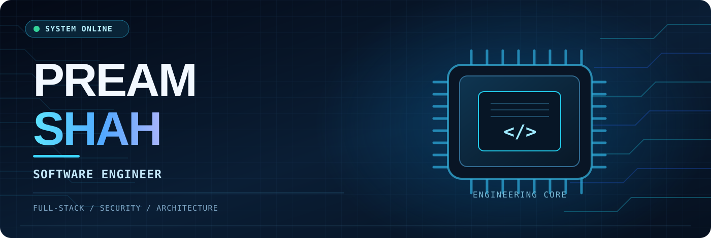
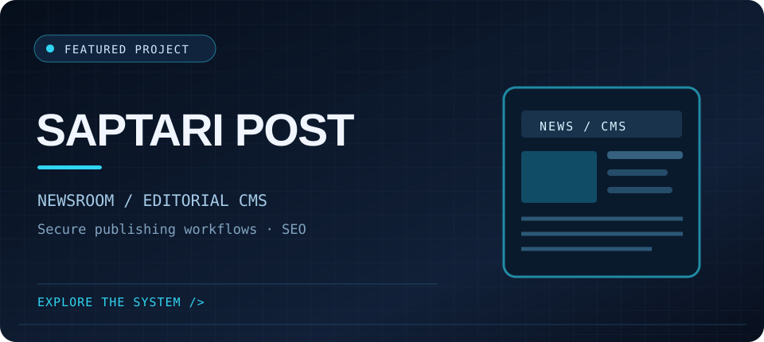
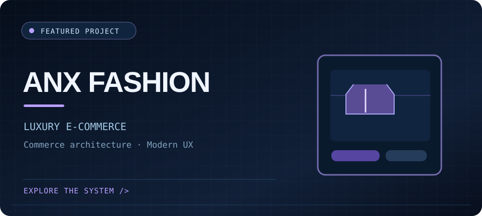
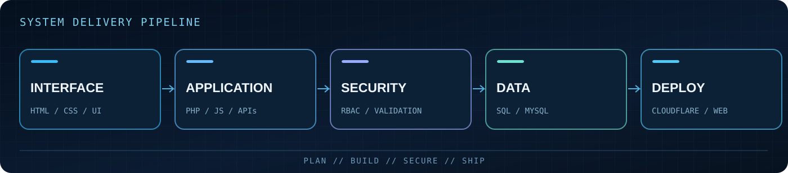

<!--
  Futuristic GitHub profile — Pream Shah
  GitHub profile README — https://github.com/preamshah/preamshah
  Graphics stored in assets/ at the repository root.
  All featured professional details are based on the supplied resume.
  Personal phone details, education, academic scores and audience metrics intentionally omitted.
-->

  

  

   

  
  
  
  

    
  <code>SOFTWARE ENGINEERING</code> · <code>FULL-STACK DEVELOPMENT</code> · <code>SECURITY</code> · <code>PERFORMANCE</code>

---

## <code>~/about</code> · The Engineer Behind the Code

<table>
  <tr>
    <td width="60%" valign="top">
      <h3>Hey, I'm Pream 👋</h3>
      
I am a <b>Full-Stack Developer and Software Engineer</b> who enjoys turning complex ideas into secure, scalable and well-crafted digital products.

      
My work spans <b>application architecture, backend systems, responsive interfaces, relational databases, deployment, technical SEO and performance optimization.</b>

      
I'm the <b>Founder & Lead Developer</b> of <a href="https://saptaripost.com/"><b>Saptari Post</b></a>, where I work on a custom news publishing platform and the systems that power editorial workflows, user experiences and content delivery.

    </td>
    <td width="40%" valign="top">
      <h3><code>engineer.config</code></h3>
      <pre>
role:     Full-Stack Engineer
focus:    Web Applications
build:    CMS + E-Commerce
mindset:  Security by Design
ship:     Optimize + Deploy
      </pre>
      
<b>Current interests:</b> architecture, platform engineering, developer experience and shipping production-ready software.

    </td>
  </tr>
</table>

## <code>~/stack</code> · My Engineering Toolkit

  
<b>Languages · Frameworks · Runtime</b>

  
   
  
<b>Interface · Data · Infrastructure · Workflow</b>

  

 

<table>
  <tr>
    <td width="50%" valign="top"><b>⌘ Backend & APIs</b> Core PHP · Laravel · Node.js · Express · MVC · REST APIs · Authentication & Authorization</td>
    <td width="50%" valign="top"><b>◈ Frontend & UX</b> React · Angular · JavaScript · HTML · CSS · Tailwind · Bootstrap · Alpine.js · Responsive Interfaces</td>
  </tr>
  <tr>
    <td valign="top"><b>⌗ Databases</b> MySQL · MariaDB · PDO · SQL · Relational Data Modeling</td>
    <td valign="top"><b>⛨ Security</b> Role-Based Access Control · CSRF Protection · XSS Prevention · SQL Injection Mitigation · Secure Sessions</td>
  </tr>
  <tr>
    <td valign="top"><b>⌁ Infrastructure</b> Hostinger · Cloudflare · Apache · LiteSpeed · DNS · SSL/TLS · Git · GitHub</td>
    <td valign="top"><b>↗ Visibility & Design</b> Technical SEO · Schema Markup · Core Web Vitals · Google Search Console · GA4 · Figma · Photoshop</td>
  </tr>
</table>

## <code>~/projects</code> · Featured Systems

<table>
  <tr>
    <td width="50%" valign="top">
      
      <h3>📰 Saptari Post</h3>
      
<b>Full-Stack Digital News Portal & Editorial CMS</b>

      
Engineered a custom publishing platform with distinct <b>reader, editor and super-admin</b> workflows, production-oriented security controls, optimized media and newsroom tooling.

      
✦ Session-based authentication and email OTP 
      ✦ RBAC and editorial publishing workflows 
      ✦ Story scheduling and reader comment moderation 
      ✦ AI-assisted image alt text and technical SEO 
      ✦ Cloudflare, caching and ad management

      
<code>PHP</code> <code>MySQL</code> <code>PDO</code> <code>JavaScript</code> <code>LiteSpeed</code>

      
<a href="https://saptaripost.com/"><b>🌐 Explore Saptari Post</b></a>

    </td>
    <td width="50%" valign="top">
      
      <h3>🛍️ ANX Fashion</h3>
      
<b>Luxury Full-Stack E-Commerce Platform</b>

      
Built a modern commerce application bringing together <b>product discovery, inventory management, shopping interactions and secure role-based experiences</b>.

      
✦ Catalog search and multi-faceted filtering 
      ✦ Reusable Blade components and reactive UI 
      ✦ Shopping cart and variant selection 
      ✦ Multi-gateway payment integration 
      ✦ Role-based access and inventory management

      
<code>Laravel</code> <code>PHP</code> <code>MySQL</code> <code>Tailwind</code> <code>Alpine.js</code>

      
<a href="https://anxfashion.com/"><b>🌐 Explore ANX Fashion</b></a>

    </td>
  </tr>
</table>

## <code>~/architecture</code> · From Interface to Infrastructure

  

<table>
  <tr>
    <td width="50%" valign="top"><h4>🔐 Security by Design</h4>
Build authentication, permissions, validation and common web threat defenses into the application architecture.
</td>
    <td width="50%" valign="top"><h4>⚡ Performance Mindset</h4>
Prefer lean implementations, efficient database access, thoughtful caching and optimized delivery.
</td>
  </tr>
  <tr>
    <td valign="top"><h4>🧩 Maintainable Systems</h4>
Use clear separation of concerns, reusable components and documented workflows to keep code easier to evolve.
</td>
    <td valign="top"><h4>🚀 Production Ownership</h4>
Work across development, deployment, hosting configuration, analytics and ongoing improvements.
</td>
  </tr>
</table>

## <code>~/credentials</code> · Verified Learning

  
  
  
  

## <code>~/activity</code> · GitHub Pulse

  
  Contribution visualization is provided by an external GitHub profile service and may occasionally be unavailable.

## <code>~/connect</code> · Build Something Meaningful

  
Interested in engineering collaborations, full-stack development and building useful digital products.

  
  
  

    
  

